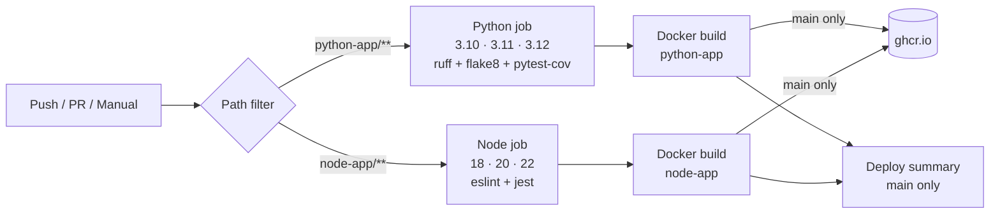

# CI/CD Pipeline for Python and Node.js

[](https://github.com/shubhamkhedkar/cicd-pipeline-python-nodejs/actions/workflows/ci-cd.yml)


[](LICENSE)

A hands-on GitHub Actions example for DevOps learners. It has two small apps,
a **Flask** API and an **Express** API. Each one is linted, tested on several
runtime versions, packaged as a Docker image, and pushed to the **GitHub Container
Registry (GHCR)**. The pipeline is free and needs no secrets.

## Pipeline



## Stages explained

| Stage | What it does | Why it matters |
|---|---|---|
| **Triggers** | Runs on push and PR to `main`, and on manual runs (`workflow_dispatch`). | Every change is checked before and after it is merged. |
| **changes** | `dorny/paths-filter` works out which app changed. | Skips work that isn't needed, so the pipeline is faster and uses fewer minutes. |
| **python** | Matrix over Python 3.10–3.12. Caches pip, runs `ruff` and `flake8`, runs `pytest` with coverage, and uploads `coverage.xml`. | Catches style issues, bugs and version-specific breakage early. |
| **node** | Matrix over Node 18/20/22. Uses `npm ci` with the npm cache, then runs `eslint` and `jest --coverage`. | Builds are reproducible from `package-lock.json` and tested on each LTS version. |
| **docker-python / docker-node** | Builds the images with Buildx and the GHA layer cache. They are **pushed only on push to `main`**, logging in with the built-in `GITHUB_TOKEN` (`packages: write`). | PRs check that the image builds without publishing anything. Only merged code becomes an artifact. |
| **deploy** | Runs only on `main`, in a `production` environment. Writes a deployment summary to the run page. | Shows where a real deployment step would go (for example `kubectl` or a cloud CLI). |

Images:
- `ghcr.io/shubhamkhedkar/cicd-python-app:latest` (plus a `:<sha>` tag)
- `ghcr.io/shubhamkhedkar/cicd-node-app:latest` (plus a `:<sha>` tag)

## Run locally

### Python app
```bash
cd python-app
python -m venv .venv && source .venv/bin/activate
pip install -r requirements-dev.txt
ruff check . && flake8 .
pytest --cov=app
python app.py            # http://localhost:5000/health
```

### Node app
```bash
cd node-app
npm ci
npm run lint
npm test
npm start                # http://localhost:3000/health
```

### Docker
```bash
docker build -t python-app ./python-app && docker run -p 5000:5000 python-app
docker build -t node-app ./node-app && docker run -p 3000:3000 node-app
# or pull the published images:
docker pull ghcr.io/shubhamkhedkar/cicd-python-app:latest
docker pull ghcr.io/shubhamkhedkar/cicd-node-app:latest
```

## Endpoints (both apps)
- `GET /health` returns `{"status": "ok"}`
- `GET /api/greet?name=X` returns `{"message": "Hello, X!"}`

## License
MIT
